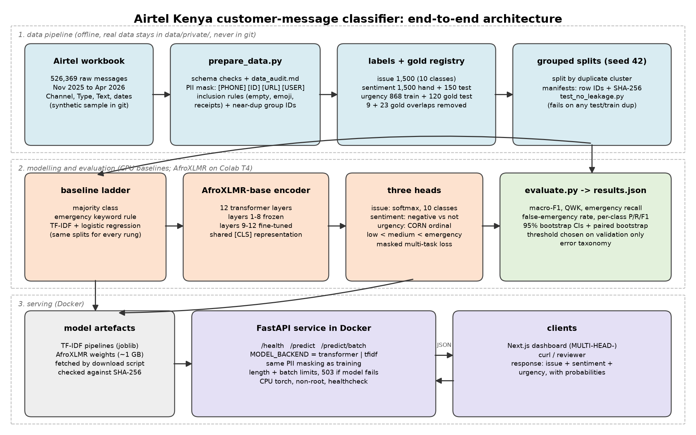
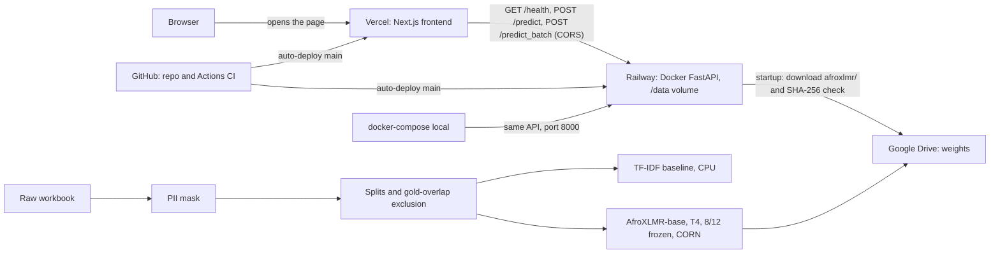

# DSA 8401 capstone — Airtel Kenya message classifier

Three decisions for one customer message: the issue (10 classes), the sentiment (`negative` or `not_negative`), and the urgency (`low`, `medium`, or `emergency`). The messages mix English, Swahili, and Sheng. The model is a shared AfroXLMR-base encoder with three heads. A TF-IDF logistic regression serves the same API when no GPU is available.



## Architecture

What is deployed now. The figure above is the training pipeline. The diagram below is the live path, including local Compose and CI.



API docs (Swagger): https://api-production-09d942cd.up.railway.app/docs. Health: https://api-production-09d942cd.up.railway.app/health. Volume `/data`, `MODEL_BACKEND=transformer`, `WEIGHTS_DIR=/data`. Frontend: https://dsa-8401-ml-capstone-project.vercel.app/.

Real customer text is not in this repository. It stays in git-ignored `data/private/`. Clearance status: cleared for coursework. The write-up is [`report/report.pdf`](report/report.pdf) (LaTeX source in [`report/latex/main.tex`](report/latex/main.tex); the markdown twin is `report/report.md`). The one-page cover is [`submission/DSA8401_submission.pdf`](submission/DSA8401_submission.pdf). Technique choices are in `docs/technique_justification.md`. Who labelled what, and which tools wrote code, is in `AI_USE.md`.

## Setup

Python 3.11 or 3.12 for the pinned `torch==2.5.1` in `requirements.txt`, which is what the Docker image and the Colab T4 run use. Python 3.13 can still `pip install -e .` because `pyproject.toml` allows `torch>=2.5.1`. From the repo root:

```bash
make install
make lint
make test
make smoke
make serve-smoke
```

`make smoke` runs the pipeline, the baselines, a one-step random encoder, and evaluation on `data/sample/`. Every number it prints is a harness check, not a result.

## Reproduction

Sample, from a clean checkout:

```bash
make install
make smoke
make serve-smoke
```

Real data, on a machine that has the export. Rename the label files to the loader names in `docs/label_rubric.md` (`FILE_MAP` in `src/capstone/labels.py` lists the original names, including `sentiment_test_to_annotate(in).csv`, `urgency_v3_train (2).csv`, and `urgency_v3_test (2).csv`).

```bash
make real DATA=/path/to/workbook.xlsx LABELS=/path/to/label_dir
```

That runs prepare, splits, baselines, AfroXLMR training, and evaluation. Outputs land in `data/private/`, `reports/`, and `artifacts/`. Do not commit them.

Colab T4 retrain: open `colab/retrain_drive.ipynb`. It clones `main`, installs with `pip install -e '.[dev]'` (no virtualenv; Colab has no `ensurepip`), mounts Drive, uploads a labels-and-manifests bundle, and trains with `--resume`. After every epoch it copies `checkpoints/last.pt` to `/content/drive/MyDrive/afroxlmr/`. The notebook stores no outputs.

The T4 run is already recorded. Seed 42, 6 of 6 epochs, 1,140 steps, about 25 minutes, no early stop. Epoch-6 validation: issue macro-F1 0.5819, sentiment macro-F1 0.8935, urgency QWK 0.5817. The emergency threshold chosen on validation is 0.50 (recall 0.810, false-emergency rate 0.179). Test macro-F1 is issue 0.656, sentiment 0.800, urgency 0.687, each above TF-IDF, with paired intervals that include zero. Full tables, the learning curve, and the three confusion matrices are in `report/report.md` and `reports/`. Smoke numbers are still harness checks.

## API

`MODEL_BACKEND` defaults to `tfidf`. That backend loads `artifacts/tfidf/{issue,sentiment,urgency}.joblib` and `artifacts/tfidf/labels.json`. Those joblibs are scikit-learn pipelines: mask, word and character TF-IDF, logistic regression, `predict_proba`. Leave the default there for a CPU reviewer.

Switch to the T4 checkpoint with:

```bash
MODEL_BACKEND=transformer TRANSFORMER_DIR=artifacts/transformer \
  .venv/bin/uvicorn capstone.serving.app:app --host 127.0.0.1 --port 8000
```

`MODEL_BACKEND=transformer` calls `capstone.models.multitask.load_for_inference`. If `TRANSFORMER_DIR` is unset, the directory is `artifacts/afroxlmr` (where `make train-transformer` writes). The download script writes the same `model.pt` to `artifacts/transformer`. Each `predict` row has the issue label and probabilities, the sentiment label and probability, and the urgency level, probabilities, and emergency flag. The service maps that onto the JSON below. A missing checkpoint stays up: `/health` is 503 and says why.

```bash
curl -s http://127.0.0.1:8000/health
curl -s -X POST http://127.0.0.1:8000/predict \
  -H 'content-type: application/json' \
  -d '{"text":"My line has been down since morning, please help"}'
curl -s -X POST http://127.0.0.1:8000/predict_batch \
  -H 'content-type: application/json' \
  -d '{"texts":["bundle haijaingia","asante"]}'
```

`/predict/batch` is the same handler as `/predict_batch`. A prediction is:

```json
{
  "issue": "Network_Issues",
  "sentiment": "negative",
  "urgency": "medium",
  "urgency_score": 0.42,
  "confidence": {"issue": 0.81, "sentiment": 0.77}
}
```

Every input goes through `mask_pii` before the model sees it. The same function masks training text. Logs record counts and lengths, not the message. Text longer than `MAX_TEXT_CHARS` (default 4000) or a batch larger than `MAX_BATCH_SIZE` (default 32) is HTTP 422, and the body does not echo the message.

`CORS_ORIGINS` is a comma-separated list. When it is unset, the API allows every origin (`*`). Set `CORS_ORIGIN_REGEX` only when you want an extra pattern on top of an explicit list.

## Docker

```bash
docker compose up --build
curl -s http://127.0.0.1:8000/health
curl -s -X POST http://127.0.0.1:8000/predict \
  -H 'content-type: application/json' \
  -d '{"text":"My line has been down since morning, please help"}'
```

The image is Python 3.12 slim. It installs `torch==2.5.1+cpu` from the CPU index, then `pip install --no-deps .` so that step does not replace it with the CUDA wheel. uvicorn listens on `0.0.0.0:$PORT` (`PORT` defaults to 8000). `MODEL_BACKEND` defaults to `tfidf`. `HEALTHCHECK` calls `/health`. If the TF-IDF directory is empty at start, the entrypoint trains the synthetic fixture so the container can answer. Mount the real `artifacts/tfidf` directory to serve those pipelines instead. With `MODEL_BACKEND=transformer`, the entrypoint runs `scripts/download_weights.py` into `WEIGHTS_DIR` unless `model.pt` already matches the SHA-256.

The same image serves the transformer when the checkpoint is mounted at `/app/artifacts/transformer/model.pt`:

```bash
MODEL_BACKEND=transformer docker compose up --build
```

## Weights

AfroXLMR weights are not in git. The T4 `model.pt` is 1,112,288,438 bytes. SHA-256:

```
778246a31841ac554fbf574cfc42cc9579981b67fb85a8eb1814dbb689ea9eb6
```

That digest is in `artifacts/transformer/weights.sha256` and `config/weights.json`. A second Colab T4 training reproduced it. The file is `afroxlmr/model.pt` in this Drive folder:

https://drive.google.com/drive/folders/1Ql5b645nf9j_UhWygj7kYqH0jaWZsDl9?usp=sharing

```bash
python scripts/download_weights.py
```

The script lists the Drive folder and downloads only `afroxlmr/` (`model.pt` and the tokenizer files). It does not pull `last.pt.tmp` or `reports/`. A file that already matches the SHA-256 is left in place. A file link still works (`AFROXLMR_WEIGHTS_URL` or `WEIGHTS_URL`). Any other URL uses urllib. A mismatch deletes the partial file and exits 1. `WEIGHTS_DIR` overrides the output directory (default `artifacts/transformer`). Training also writes `artifacts/afroxlmr/sha256.txt` for the state dict it just saved.

## Layout

```
src/capstone/prepare_data.py    workbook to parquet and an aggregate audit
src/capstone/pii.py             mask_pii, shared by training and serving
src/capstone/duplicates.py      exact and near-duplicate group ids
src/capstone/labels.py          FILE_MAP and the seven canonical filenames
src/capstone/splits.py          grouped splits, gold removal, manifests
src/capstone/models/            baselines, CORN, AfroXLMR multi-task
src/capstone/evaluate.py        test metrics, bootstrap, error file
src/capstone/serving/           FastAPI app
src/capstone/weights.py         download and SHA-256 check
docs/architecture.png           diagram above
reports/results.json            real T4 test metrics
reports/figures/                AfroXLMR confusion matrices and the learning curve
reports/afroxlmr_run/           curves.json and threshold.json from the T4 run
docs/label_rubric.md            classes, provenance, recomputed agreement
docs/technique_justification.md one row per syllabus area
report/report.pdf               the capstone report
report/latex/main.tex           LaTeX source for that PDF
submission/DSA8401_submission.pdf one-page cover
frontend/                       Next.js demo (MULTI-HEAD), calls this API
railway.json                    Railway Dockerfile service
deploy/hf_space/                optional Hugging Face Space (Docker SDK needs PRO)
colab/retrain_drive.ipynb       T4 retrain with Drive resume, no stored outputs
data/sample/                    fictional workbook and labels, seed 42
data/private/                   git-ignored real data
```

## Pipeline notes

`prepare_data` fails if a required column is missing, keeps original channel and type beside the normalised values, counts and drops `Unnamed:` overflow columns, and assigns `dup_group_id`. Dates outside 2025-11-01 through 2026-04-17 are counted and kept. The platform `Sentiment` column is not the hand label.

Near-duplicates use character 3-gram MinHash (32 permutations, 8 bands of 4, seed 42) plus shared prefixes, confirmed at Dice 0.80. Training examples are one per source row id. Two rows that normalise to the same string both stay, so a label is not dropped.

The emergency threshold is chosen on the urgency validation split only: maximise recall subject to a false-emergency rate of at most 0.20, then apply it once to test. `evaluate.py` skips a model whose artefact is missing and records `not evaluated` in `results.json`. Mistakes go to `data/private/errors.csv` with a category hint. Thirty are marked for the taxonomy. That file is git-ignored.

Do not commit `.xlsx`, `.csv`, or `.parquet` outside `data/sample/`. Do not commit `.env*`, `__pycache__/`, `node_modules/`, `.next/`, or model weights.

## Live demo / deployment

The browser UI is `frontend/`, copied from [MULTI-HEAD-](https://github.com/ChristopherKiokoStrathmore/MULTI-HEAD-). `NEXT_PUBLIC_API_URL` is the FastAPI base URL. The page calls `/health`, `/predict`, and `/predict_batch`. The JSON shapes match `lib/types.ts` and `src/capstone/serving/schemas.py`.

The live frontend is https://dsa-8401-ml-capstone-project.vercel.app/. API docs (Swagger): https://api-production-09d942cd.up.railway.app/docs. Health: https://api-production-09d942cd.up.railway.app/health.

Hosting is Railway Hobby. `railway.json` builds the root `Dockerfile`, checks `/health` (15 minute timeout, so the first-start download can finish), and restarts on failure. The service has a volume at `/data`, `MODEL_BACKEND=transformer`, `WEIGHTS_DIR=/data`, and `CORS_ORIGINS` (the default `*` already allows https://dsa-8401-ml-capstone-project.vercel.app). The process needs about 3 GB of RAM. The checkpoint is 1.1 GB. Steps are in `deploy/README.md`.

The frontend is on Vercel with root `frontend` and `NEXT_PUBLIC_API_URL` set to the Railway URL. A second Railway service with that root directory is the other option.

A Hugging Face Docker Space (`deploy/hf_space/`, `Kioko1/airtel-multihead`) is optional. Free Docker Spaces return HTTP 402 and need a PRO plan. `make hf-space` is unchanged.
