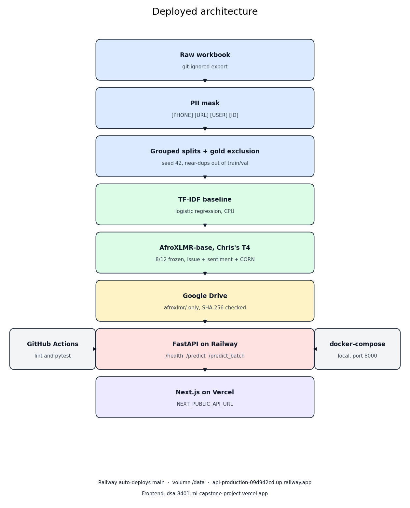
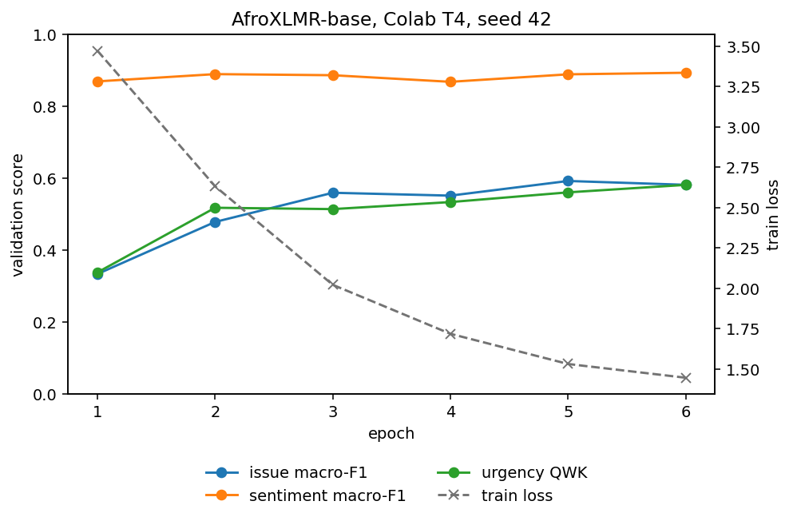
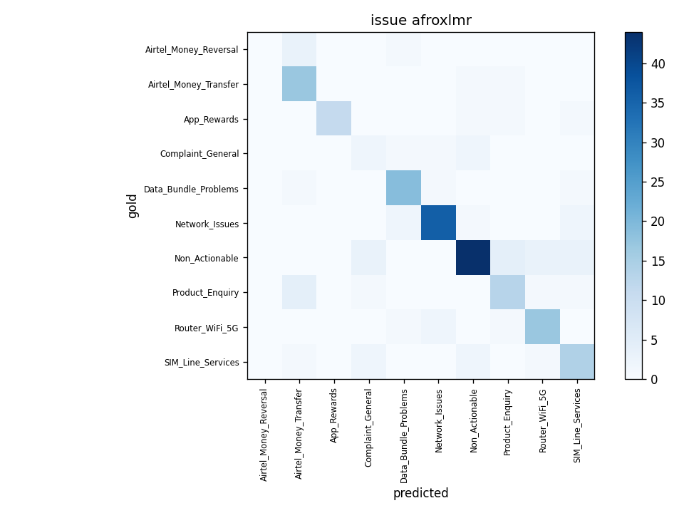
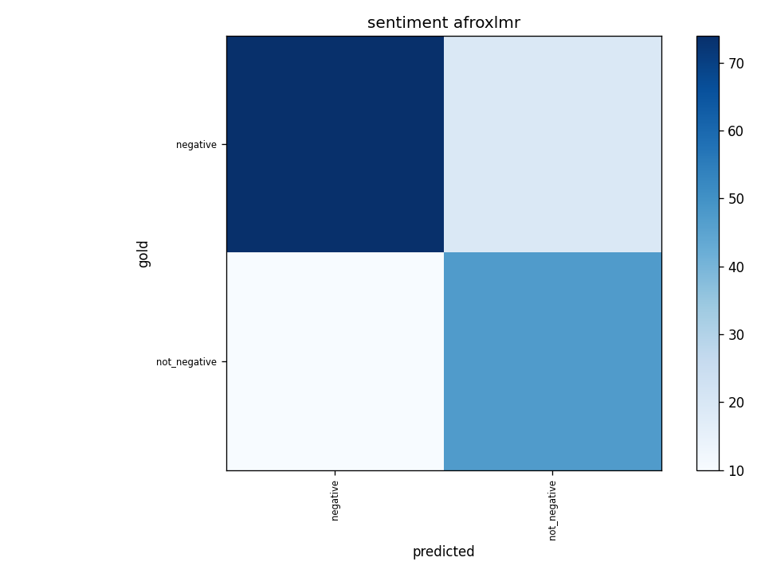
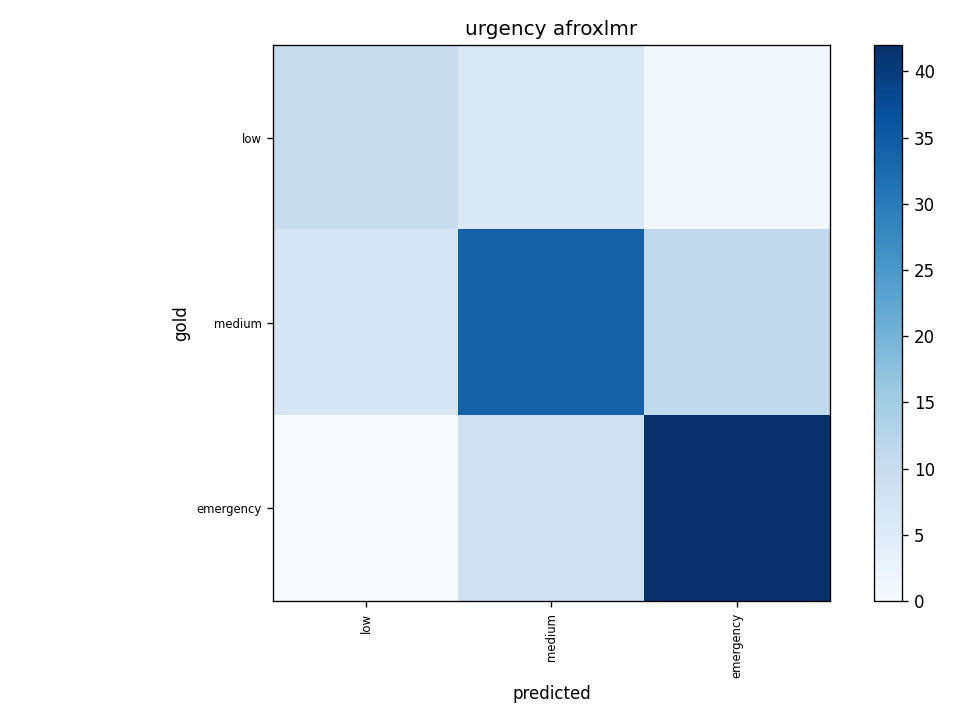

# Airtel Kenya customer-message classifier

DSA 8401 capstone. Chris Kioko. Clearance status: **cleared for coursework**.

No customer message is quoted in this report. Counts and metrics are aggregates.

## Problem framing

Airtel Kenya's customer-care queue receives short messages in English, Swahili, and Sheng. Each message needs three decisions at once: what the customer is asking about (10 issue classes), whether the tone is negative, and how quickly the message should move (low, medium, or emergency). The messages are raw exports, not a cleaned benchmark. Missing text, receipts, duplicates, and label leakage are part of the problem.

The live demo schema is the three-head JSON in [MULTI-HEAD-](https://github.com/ChristopherKiokoStrathmore/MULTI-HEAD-) `lib/types.ts`. This repository trains and serves that schema.

## Data

The workbook is one sheet, 526,369 rows by 29 columns, posted from November 2025 through April 2026. Channels are Airtel Kenya page variants and the Twitter handles. `prepare_data` keeps the original channel and type beside a normalised form, masks PII as `[PHONE]`, `[URL]`, `[USER]`, and `[ID]`, and drops rows that fail the inclusion rules.

Real workbook audit:

| | rows |
| --- | ---: |
| in | 526,369 |
| kept | 379,575 |
| empty | 47,004 |
| non-linguistic | 98,317 |
| auto receipts | 1,473 |

Label files are already masked. Original names and the loader names are in `docs/label_rubric.md` and `FILE_MAP`.

| Head | Source | Real split (train / val / test) |
| --- | --- | --- |
| Issue | `issue_retagged_clean_1500.csv`, 10 classes, retagged by Chris | 1,028 / 226 / 224 |
| Sentiment | hand labels in `sentiment_judgment_1500.csv`; test is `sentiment_test_to_annotate(in).csv` | 1,215 / 260 / 150 |
| Urgency | `urgency_v3_train (2).csv` and `urgency_v3_test (2).csv` | 794 / 60 / 120 |

Urgency validation is 60 rows and every one of them is gold. The 120-row test is the fixed gold file. 688 urgency training rows are Groq silver (`source=distilled`) and are down-weighted. Gemini's `gemini_relabeled.csv` is not a training source.

Platform sentiment versus hand sentiment, recomputed: agreement 0.711 and kappa 0.427 on 1,499 unique normalised texts. Row-aligned on all 1,500 rows the same agreement is 0.711 and kappa is 0.428. The platform file is the agreement table only.

Exact overlaps, recomputed: 9 urgency-test messages also sit in the issue/sentiment 1,500, 23 sit in the Gemini file, and 0 sit in the urgency training file. Gold, including near-duplicates, is removed from every training and validation pool. Splits are grouped on `dup_group_id`, seed 42.

## Deployed architecture

Raw workbook to PII mask, grouped splits, and gold-overlap exclusion. TF-IDF logistic regression is the CPU baseline. AfroXLMR-base (bottom 8 of 12 frozen, issue, sentiment, and CORN urgency) was trained on Chris's Colab T4. The checkpoint is on Google Drive and checked by SHA-256 into the Railway volume at `/data`. FastAPI (`/health`, `/predict`, `/predict_batch`) runs in Docker at https://api-production-09d942cd.up.railway.app and auto-deploys from `main`. The Next.js app at https://dsa-8401-ml-capstone-project.vercel.app/ uses `NEXT_PUBLIC_API_URL`. GitHub Actions runs lint and pytest. `docker-compose` is the local path on port 8000.

## Pipeline

`prepare_data.py` reads the workbook once, checks the required columns, writes parquet under `data/private/`, and writes an aggregate audit with no message text. Inclusion drops empty text, text with no letters, and auto receipts. Exact duplicates and near-duplicates share `dup_group_id` (character 3-gram MinHash, Dice at least 0.80).

`splits.py` writes a JSON manifest per head: row ids, the duplicate group, and the SHA-256 of each source file. `tests/test_no_leakage.py` fails if any exact or near-duplicate is in both test and train/validation.

Real data stays in git-ignored `data/private/`. The repository ships a seed-42 synthetic sample. `make smoke` runs the pipeline, the baselines, a one-step tiny encoder, and evaluation on that sample. Those numbers are a harness check.

## Models

Every rung uses the same splits. Nothing is chosen on the test set.

1. Majority class, fit on train.
2. Keyword heuristic, with emergency, medium, and issue cues. Unmatched text falls back to the training majority.
3. TF-IDF, word bigrams and character 3–5 grams, then logistic regression with balanced class weights. `C` is chosen on validation only, then the pipeline is refit on train.
4. AfroXLMR-base, one seed (42). Embeddings and the bottom 8 of 12 layers are frozen. The top 4 layers and three heads train: issue softmax, sentiment softmax, urgency CORN. Masked loss, class weights, and urgency row weights. Early stopping uses validation macro-F1 and quadratic weighted kappa. The Colab T4 run used all 6 planned epochs (1,140 steps, about 25 minutes) and did not stop early. Epoch 6 validation: issue macro-F1 0.5819, sentiment macro-F1 0.8935, urgency QWK 0.5817 (`reports/afroxlmr_run/curves.json`). The checkpoint is `model.pt`, 1,112,288,438 bytes, SHA-256 `778246a31841ac554fbf574cfc42cc9579981b67fb85a8eb1814dbb689ea9eb6`.

Base rather than large is a size decision. The proposal froze 8 of 24 layers. Freezing 8 of 12 keeps that one-third trainable and fits one Colab T4. The deviation is recorded in `docs/technique_justification.md`.

The emergency flag is a threshold on P(emergency). It is chosen on the urgency validation split to maximise recall subject to a false-emergency rate of at most 0.20, then applied once to test.

## Evaluation

`evaluate.py` scores whichever artefacts exist. If `artifacts/afroxlmr` is missing, that model is `not evaluated` in `results.json` and the baselines are still scored. Metrics, on the test split only: macro-F1, per-class precision, recall, and F1 with support, confusion matrices, urgency quadratic weighted kappa, emergency recall, and false-emergency rate. Intervals are 95% percentile bootstrap, 1,000 resamples, seed 42. Paired intervals compare each scored model with TF-IDF on the same resamples. Mistakes go to `data/private/errors.csv` with a category hint. Thirty of them are marked for the error taxonomy. The report does not copy message text out of that file.

## Results

The tables are the real test-split evaluation (`reports/results.json`, `kind: data`). They are not the smoke harness. AfroXLMR figures are the Colab T4 checkpoint, seed 42. Rounded to three decimals the same way `evaluate.py` writes `results.md`.

Validation curves (`reports/afroxlmr_run/curves.json`):

Emergency threshold on validation (real data). AfroXLMR's threshold is 0.50 (`reports/afroxlmr_run/threshold.json`): validation emergency recall 0.810, false-emergency rate 0.179, under the 0.20 cap.

| model | threshold | val recall | val false-emergency rate | met cap |
| --- | ---: | ---: | ---: | --- |
| majority | 0.95 | 0.000 | 0.000 | yes |
| keyword | 0.80 | 0.095 | 0.026 | yes |
| tfidf | 0.45 | 0.714 | 0.154 | yes |
| afroxlmr | 0.50 | 0.810 | 0.179 | yes |

### Issue (n = 224)

Gold support: Airtel_Money_Reversal 4, Airtel_Money_Transfer 19, App_Rewards 14, Complaint_General 6, Data_Bundle_Problems 22, Network_Issues 41, Non_Actionable 57, Product_Enquiry 20, Router_WiFi_5G 21, SIM_Line_Services 20.

| model | macro-F1 | 95% CI |
| --- | ---: | --- |
| majority | 0.041 | [0.033, 0.048] |
| keyword | 0.411 | [0.318, 0.474] |
| tfidf | 0.636 | [0.542, 0.714] |
| afroxlmr | 0.656 | [0.595, 0.707] |

TF-IDF per-class F1 (support in parentheses): reversal 0.40 (4), transfer 0.74 (19), rewards 0.81 (14), general complaint 0.20 (6), data bundle 0.67 (22), network 0.81 (41), non-actionable 0.78 (57), product enquiry 0.47 (20), router/Wi-Fi 0.75 (21), SIM/line 0.73 (20).

AfroXLMR per-class F1: reversal 0.00 (4), transfer 0.76 (19), rewards 0.88 (14), general complaint 0.29 (6), data bundle 0.83 (22), network 0.89 (41), non-actionable 0.81 (57), product enquiry 0.65 (20), router/Wi-Fi 0.79 (21), SIM/line 0.67 (20). On Airtel_Money_Reversal (n = 4) AfroXLMR scores F1 0.00, where TF-IDF scores 0.40.

Paired macro-F1 minus TF-IDF: majority −0.596 [−0.673, −0.501]; keyword −0.226 [−0.360, −0.103]; AfroXLMR +0.020 [−0.062, 0.117].

### Sentiment (n = 150)

Gold support: negative 93, not_negative 57.

| model | macro-F1 | 95% CI |
| --- | ---: | --- |
| majority | 0.383 | [0.353, 0.409] |
| keyword | 0.383 | [0.353, 0.409] |
| tfidf | 0.758 | [0.685, 0.825] |
| afroxlmr | 0.800 | [0.727, 0.863] |

TF-IDF per-class F1: negative 0.80 (93), not_negative 0.71 (57). AfroXLMR: negative 0.84 (93), not_negative 0.76 (57). Majority and the keyword rule both score 0.77 on negative and 0.00 on not_negative, which is why their macro-F1 matches.

Paired macro-F1 minus TF-IDF: majority −0.375 [−0.454, −0.291]; keyword −0.375 [−0.454, −0.291]; AfroXLMR +0.043 [−0.017, 0.099].

### Urgency (n = 120)

Gold support: low 17, medium 52, emergency 51 (69 non-emergency).

| model | macro-F1 | 95% CI | QWK | emergency recall | false-emergency rate |
| --- | ---: | --- | ---: | ---: | ---: |
| majority | 0.199 | [0.170, 0.227] | 0.000 | 0.000 | 0.000 |
| keyword | 0.215 | [0.155, 0.272] | 0.044 | 0.000 | 0.043 |
| tfidf | 0.633 | [0.526, 0.723] | 0.554 | 0.667 | 0.174 |
| afroxlmr | 0.687 | [0.589, 0.770] | 0.687 | 0.804 | 0.145 |

TF-IDF per-class F1: low 0.48 (17), medium 0.67 (52), emergency 0.74 (51). AfroXLMR: low 0.59 (17), medium 0.67 (52), emergency 0.80 (51).

Paired macro-F1 minus TF-IDF: majority −0.434 [−0.536, −0.324]; keyword −0.418 [−0.511, −0.307]; AfroXLMR +0.055 [−0.020, 0.135].

AfroXLMR's point estimate is above TF-IDF on all three heads. The paired bootstrap intervals on those macro-F1 differences all include zero (issue +0.020 [−0.062, 0.117], sentiment +0.043 [−0.017, 0.099], urgency +0.055 [−0.020, 0.135]), so the test sizes do not show a significant macro-F1 gain. Two urgency contrasts do separate: paired QWK +0.133 [0.002, 0.272] and paired emergency recall +0.137 [0.036, 0.259]. At the validation threshold, test emergency recall is 0.804 against TF-IDF 0.667, and the false-emergency rate is 0.145 against 0.174.

TF-IDF and AfroXLMR are both well above the majority and keyword baselines on every head. The two smallest issue classes, reversal (n = 4) and general complaint (n = 6), stay weak. Reversal is the class where the transformer loses to TF-IDF.

## Limitations

- One seed (42). There is no seed interval around the transformer.
- The urgency test is 120 messages. Emergency recall on 51 gold emergencies moves quickly when a few rows flip.
- Two issue classes have support 4 and 6. A single error changes their F1 a lot. The bootstrap intervals on issue macro-F1 are wide for that reason.
- 688 urgency training rows are silver labels from Groq, not Chris's gold. They are weighted down, but they are still in the training loss.
- The encoder is AfroXLMR-base, not large. The frozen fraction matches the proposal; the capacity does not.
- The T4 point estimates favour AfroXLMR, and the macro-F1 intervals still include zero. A second seed or a larger test would be needed before calling the gain significant.

## Real-world relevance

The queue still has to route a code-switched message, judge the tone, and decide whether it is an emergency. A TF-IDF service already runs without a GPU (`MODEL_BACKEND=tfidf`). The transformer path is the same API with the checkpoint swapped. Masking is the same function at training and at request time, so the text the model sees does not grow a second copy of a phone number or an ID. Duplicate groups keep a near-copy of a gold emergency out of training.

Clearance status: cleared for coursework. The raw export is not in the git repository.

## Rubric to artefact

The capstone is 60% of the course. Weights are the brief's.

| Rubric row | Weight | Where it is |
| --- | ---: | --- |
| Data pipeline | 10% | `src/capstone/prepare_data.py`, `pii.py`, `duplicates.py`, `docs/label_rubric.md`, real audit counts above |
| Modelling and evaluation | 20% | `src/capstone/models/`, `evaluate.py`, this results section, `reports/results.json` on a real run |
| Technique justification | 10% | `docs/technique_justification.md` |
| Deployment (API and Docker) | 10% | `src/capstone/serving/`, `Dockerfile`, `docker-compose.yml`, `make serve-smoke` |
| Final report and presentation | 10% | this file |
| Total | 60% | |
